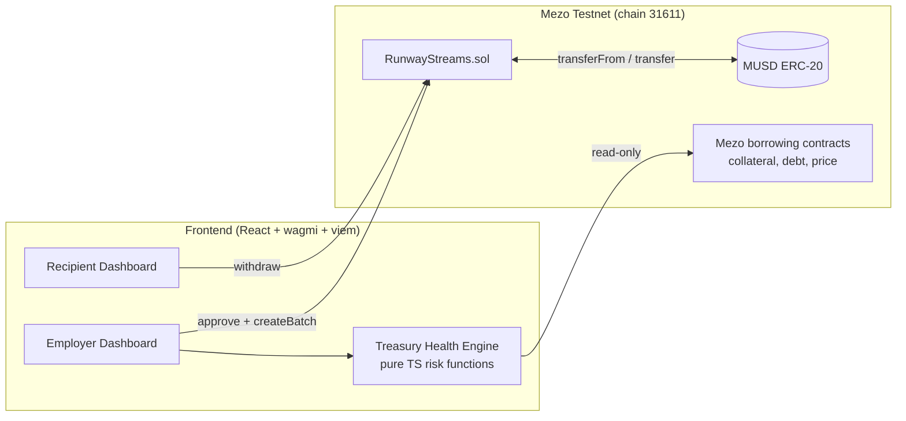

# Runway

### Pay your team in MUSD. Keep your Bitcoin.

Runway is a payroll and contractor-payment app for Bitcoin holders, built on [Mezo](https://mezo.org). Teams borrow **MUSD** (Mezo's Bitcoin-backed stablecoin) against their BTC, stream salaries to any number of recipients by the second in a single batch transaction, and watch a live **Treasury Health** panel that stress-tests whether payroll stays covered if BTC drops, so they never have to sell BTC or risk liquidation to pay people.

> Built for the **Mezo Buildathon on AKINDO, Wave 1**.
> **Tracks:** Track 2 (Access & Distribution: payments), with Track 1 composability (BTC collateral as productive capital).
> **Chain:** Mezo Testnet (chain ID 31611)

| | |
|---|---|
| **Live demo** | `[ADD LINK]` |
| **Demo video (2 min)** | `[ADD LINK]` |
| **Pitch deck** | `[ADD LINK]` |
| **Deployed contract** | `[ADD EXPLORER LINK]` |
| **Team** | `[ADD NAMES + X/LINKEDIN]` |

---

## Table of Contents

1. [The Problem](#the-problem)
2. [The Solution](#the-solution)
3. [How Runway Uses MUSD and Mezo](#how-runway-uses-musd-and-mezo)
4. [Features](#features)
5. [Architecture](#architecture)
6. [Smart Contract Design](#smart-contract-design)
7. [Treasury Health Engine](#treasury-health-engine)
8. [Tech Stack](#tech-stack)
9. [Repository Structure](#repository-structure)
10. [Getting Started](#getting-started)
11. [Network and Token Reference](#network-and-token-reference)
12. [Testing](#testing)
13. [Deployment](#deployment)
14. [Demo Walkthrough](#demo-walkthrough)
15. [Security Considerations](#security-considerations)
16. [Project Status](#project-status)
17. [Roadmap and Milestones](#roadmap-and-milestones)
18. [Mapping to Judging Criteria](#mapping-to-judging-criteria)
19. [Challenges and Learnings](#challenges-and-learnings)
20. [Team](#team)
21. [License](#license)

---

## The Problem

Bitcoin-rich teams, DAOs, and founders face a bad choice when they need to pay people:

- **Sell BTC:** this triggers taxable events and gives up long-term upside.
- **Hold BTC:** the treasury stays illiquid and payroll can't be funded.

Mezo lets holders borrow MUSD against their BTC, which solves the liquidity side. But two gaps remain:

1. **There is no payment workflow around MUSD.** Borrowed MUSD sits in a wallet. Paying a team means many manual transfers, with no streaming, batching, or per-second accrual.
2. **There is no visibility into payroll risk.** A borrower paying out MUSD every month has no easy way to see whether their BTC-backed position survives a price drop, and a liquidation can wipe out the treasury.

## The Solution

Runway connects borrowing to paying, with risk awareness built in.

1. **Borrow:** the employer borrows MUSD against BTC on Mezo.
2. **Stream:** the employer creates a batch of payment streams (one approval, one transaction). MUSD accrues to each recipient every second.
3. **Withdraw:** recipients watch a live ticking balance and withdraw whenever they like.
4. **Stay safe:** the Treasury Health panel reads the employer's live Mezo position and answers: *"If BTC drops 30%, is my position still safe, and how many months of payroll are covered?"*

Runway turns MUSD from something you **hold** into something you **pay with**.

**Who it's for:** Bitcoin-native companies, DAOs, and founders who pay contractors; freelancers who want to be paid in a BTC-backed stable asset; desktop and mobile web users.

## How Runway Uses MUSD and Mezo

| Integration point | What Runway does |
|---|---|
| **MUSD as the payment asset** | Every stream is denominated in MUSD. The contract is MUSD-only and reads the token's `decimals()` at runtime. |
| **Live Mezo borrow-position data** | The Treasury Health module reads collateral, debt, collateral ratio, BTC price, and minimum collateral ratio from Mezo's on-chain contracts. |
| **Composability with Mezo borrowing** | The "Fund from Bitcoin" panel previews the new collateral ratio and liquidation price before borrowing, and routes the user to Mezo's borrow flow (in-app borrowing is on the roadmap). |
| **Deployed on Mezo** | The streaming contract is deployed on Mezo Testnet and is a pure ERC-20 consumer, so it composes with any MUSD-based tooling. |

Runway **extends** existing Mezo products rather than detouring from them: it is a payments layer on top of Mezo's borrow flow.

## Features

**Employer dashboard**
- Treasury Health card: collateral (BTC), debt (MUSD), collateral ratio gauge, liquidation price, BTC price, payroll runway in months
- **Stress-test slider** (BTC price drop 0-60%) with a plain-English verdict
- Create payroll: add rows or paste a CSV of `address, amount`, one approval, one batch transaction
- Streams table with progress, withdrawn amounts, and cancel with a refund preview

**Recipient dashboard**
- Live ticking "Available to withdraw" balance
- One-click withdraw
- List of incoming streams with progress

**Contract**
- Linear per-second streaming, batch creation, partial or full withdrawal, sender cancellation with an exact split of streamed vs. refundable funds

## Architecture



**Data flow:** the frontend talks directly to Mezo's RPC; there is no custom backend or database. All stream state lives on-chain, and all risk calculations are pure functions run client-side over on-chain reads. This keeps Runway trust-minimized and easy to verify.

## Smart Contract Design

`contracts/contracts/RunwayStreams.sol` (Solidity ^0.8.24, OpenZeppelin v5)

```solidity
struct Stream {
    address sender;
    address recipient;
    uint256 deposit;
    uint256 withdrawn;
    uint40  start;
    uint40  end;
    bool    cancelled;
}
```

**Core logic**

- Accrual: `streamed = deposit * (min(now, end) - start) / (end - start)`, rounded down. It is `0` before `start` and equals `deposit` at or after `end`.
- `createStream` / `createBatch`: pull the total MUSD in a single `transferFrom` (employer approves once); batch size is capped.
- `withdraw` / `withdrawMax`: recipient only.
- `cancel`: sender only; pays the recipient `streamed - withdrawn` and refunds the remainder to the sender.
- Views: `streamedAmount`, `withdrawableAmount`, `refundableAmount`, `getStream`, `streamIdsBySender`, `streamIdsByRecipient`.

**Design principles**

- No admin keys, no upgradeability, no fees, no pause switch: nothing for a privileged party to abuse
- `ReentrancyGuard`, `SafeERC20`, checks-effects-interactions, custom errors
- Rounding always favors the contract, so total payouts can never exceed the deposit

## Treasury Health Engine

`src/lib/mezo/` is a pure-TypeScript module (no React) so the math is unit-testable.

| Function | Purpose |
|---|---|
| `getTroveSnapshot(address)` | Reads collateral, debt, collateral ratio, BTC price, liquidation price, minimum ratio, and interest rate from Mezo contracts |
| `stressTest(snapshot, dropPercent)` | Returns the new ratio and a status: `safe`, `warning`, or `liquidatable` |
| `runway({ idleMusd, monthlyPayrollBurn, snapshot, safetyRatio })` | Months of payroll covered by idle MUSD plus safely borrowable headroom |
| `borrowPreview(snapshot, extraMusd)` | Resulting ratio and liquidation price after borrowing more |

**Formulas**

```
collateralRatio    = (collateralBTC * btcPriceUSD) / debtMUSD
stressedRatio      = (collateralBTC * btcPriceUSD * (1 - drop)) / debtMUSD
liquidationPrice   = (minCollateralRatio * debtMUSD) / collateralBTC
borrowableHeadroom = max(0, (collateralBTC * btcPriceUSD) / safetyRatio - debtMUSD)
runwayMonths       = (idleMUSD + borrowableHeadroom) / monthlyPayrollBurn
```

The minimum collateral ratio and interest rate are **read from the contracts, never hardcoded**. All token math uses `bigint`.

## Tech Stack

| Layer | Tools |
|---|---|
| Smart contracts | Solidity, Hardhat, OpenZeppelin v5, Chai |
| Mezo integration | Mezo Testnet, MUSD, viem |
| Frontend | React, Vite, TypeScript, Tailwind CSS, shadcn/ui, wagmi, react-router |
| Testing | Hardhat tests, Vitest |
| Tooling | Lovable (frontend generation), Google Antigravity (AI-assisted development) |

## Repository Structure

```
runway/
├── contracts/                     # Hardhat project
│   ├── contracts/
│   │   ├── RunwayStreams.sol
│   │   └── mocks/MockERC20.sol
│   ├── test/RunwayStreams.test.ts
│   ├── scripts/
│   │   ├── deploy.ts
│   │   └── seed.ts                # creates demo streams
│   └── hardhat.config.ts
├── deployments/
│   └── mezo-testnet.json          # deployed address, token, tx hash
├── src/
│   ├── components/
│   ├── pages/                     # Landing, Employer, Recipient, About
│   └── lib/
│       ├── api.ts                 # data layer (mock or on-chain)
│       ├── abi/RunwayStreams.json
│       └── mezo/                  # chain.ts, trove.ts, risk.ts (+ tests)
├── .env.example
└── README.md
```

## Getting Started

### Prerequisites

- Node.js 20+ and npm
- MetaMask (or another EVM wallet)
- Git

### 1. Clone and install

```bash
git clone [YOUR_REPO_URL] runway
cd runway
npm install
cd contracts && npm install && cd ..
```

### 2. Add Mezo Testnet to your wallet

| Field | Value |
|---|---|
| Network name | Mezo Testnet |
| RPC URL | `https://rpc.test.mezo.org` |
| Chain ID | `31611` |
| Currency | BTC |
| Explorer | `https://explorer.test.mezo.org` |

### 3. Get test funds

- **Testnet BTC (for gas):** https://faucet.test.mezo.org/
- **Testnet MUSD:** MUSD is *not* dispensed by the faucet; you borrow it against testnet BTC at https://mezo.org/feature/borrow (connect on Mezo Testnet).

Use two wallets to try the full flow: one **employer** and one **recipient**.

### 4. Configure environment

```bash
cp .env.example .env
```

```env
# contracts/deploy
PRIVATE_KEY=0xYOUR_DEPLOYER_PRIVATE_KEY      # testnet only, never commit

# frontend
VITE_USE_MOCK=false                           # true = run UI on mock data
VITE_MEZO_RPC_URL=https://rpc.test.mezo.org
```

### 5. Run the frontend

```bash
npm run dev
```

Open the printed local URL, connect your wallet on Mezo Testnet, and choose **Employer** or **Recipient**.

> Set `VITE_USE_MOCK=true` to explore the UI without a wallet or any on-chain data.

## Network and Token Reference

| | Mezo Testnet | Mezo Mainnet |
|---|---|---|
| Chain ID | 31611 | 31612 |
| RPC | `https://rpc.test.mezo.org` | see [Mezo docs](https://mezo.org/docs/developers/) for providers |
| MUSD token | `0x118917a40FAF1CD7a13dB0Ef56C86De7973Ac503` | `0xdD468A1DDc392dcdbEf6db6e34E89AA338F9F186` |
| MUSD decimals | read on-chain via `decimals()` (documented as 18) | same |

Always cross-check addresses against the official docs and the block explorer before use: https://mezo.org/docs/developers/

## Testing

**Smart contracts**

```bash
cd contracts
npx hardhat test
```

Coverage includes: accrual at 0%, 50%, and 100% via time travel; partial and full withdrawals; cancel split correctness; batch creation; access control; every revert path; rounding safety; and a randomized invariant that `recipient payouts + refund == deposit`.

**Treasury Health engine**

```bash
npm run test          # Vitest: risk.ts and trove.ts logic
```

**End-to-end (manual, two wallets on Mezo Testnet)**

1. Employer approves MUSD and creates a batch of streams
2. Time passes and the recipient's balance ticks up
3. Recipient withdraws partially
4. Employer cancels and the refund split matches the preview
5. Every transaction is verified on the Mezo explorer

## Deployment

**Contracts (Mezo Testnet)**

```bash
cd contracts
npx hardhat run scripts/deploy.ts --network mezoTestnet
npx hardhat run scripts/seed.ts   --network mezoTestnet   # optional demo data
```

The deploy script writes `deployments/mezo-testnet.json` and exports the ABI to `src/lib/abi/RunwayStreams.json`.

| Contract | Network | Address | Explorer |
|---|---|---|---|
| RunwayStreams | Mezo Testnet | `[ADD AFTER DEPLOY]` | `[ADD LINK]` |

**Frontend**

```bash
npm run build         # outputs /dist
```

Deploy `/dist` to any static host (Lovable publish, Vercel, Netlify, or GitHub Pages). No backend is required.

## Demo Walkthrough

1. **Landing:** the value proposition and a live ticking counter.
2. **Employer, Treasury Health:** connect a wallet with an open Mezo position, then drag the stress slider to -30% and read the verdict.
3. **Employer, Create payroll:** paste three recipients, approve, and create all streams in one transaction.
4. **Recipient:** switch wallets, watch the balance tick, and withdraw.
5. **Employer, Cancel:** preview the refund split, then confirm and verify on the explorer.

Screenshots: `[ADD /docs/screenshots/...]`

## Security Considerations

- **Not audited.** This is a hackathon MVP running on testnet; do not use it with real funds without an independent review.
- No privileged roles, no upgrade path, and no custody beyond the stream deposits themselves.
- Reentrancy protection and safe token transfers are used throughout; rounding always rounds down.
- The contract treats MUSD as a standard ERC-20 and rejects zero addresses, zero amounts, zero durations, and mismatched batch arrays.
- Risk calculations are estimates based on current on-chain data; they are **not** a guarantee against liquidation. Real prices can move faster than a dashboard updates.
- Never commit private keys. `.env` is gitignored.

## Project Status

> Built during the Mezo Buildathon, Wave 1 (October 16-26, 2026). This is an entirely new project.

- [ ] `RunwayStreams` contract written and fully tested
- [ ] Contract deployed to Mezo Testnet
- [ ] Treasury Health engine reading a live Mezo position
- [ ] Employer and Recipient dashboards wired to on-chain data
- [ ] End-to-end flow verified with two wallets
- [ ] Demo video and deck complete
- [ ] "Fund from Bitcoin" borrow preview (P1)
- [ ] In-app borrow transaction (roadmap)

*(Tick these off as you ship and keep this list honest.)*

## Roadmap and Milestones

| Milestone | Timeline | Scope |
|---|---|---|
| **1. Wave 1 MVP** | Oct 16-26, 2026 | Streaming contract on Mezo Testnet, Employer and Recipient dashboards, Treasury Health with stress test |
| **2. Wave 2 depth** | by Nov 15, 2026 | In-app borrow-to-fund through Mezo's borrow contracts, mainnet deployment, improved batch and CSV tooling |
| **3. Recipient experience** | December 2026 | Telegram claim alerts, MUSD-to-BTC swap-out through Mezo's router |
| **4. Treasury-grade features** | Q1 2027 | Multisig / DAO treasury support, automated liquidation-risk alerts, independent security review |

**Long-term commitment:** Runway is meant to continue after the hackathon. Wave 2 submissions will list exactly what changed since Wave 1.

## Mapping to Judging Criteria

| Criterion (weight) | How Runway addresses it |
|---|---|
| **Mezo Integration (30%)** | MUSD is the only payment asset; live Mezo borrow-position data drives the Treasury Health engine; the design extends Mezo's borrow flow rather than sitting beside it |
| **Product and Business Viability (30%)** | Real pain point for Bitcoin-native teams (selling BTC to pay people); extends MUSD from a held asset to a payment asset; clear users (DAOs, Bitcoin companies, freelancers); fits Track 2 (access and payments) and Track 1 (BTC collateral as productive capital) |
| **Technical Implementation (20%)** | Minimal, key-less, tested contract; invariant tests; pure-function risk engine with unit tests; composable ERC-20 design; deployed on Mezo |
| **User Experience (10%)** | Live ticking balances, stress-test slider with plain-English verdicts, clear transaction states, responsive and accessible UI |
| **Submission Materials (10%)** | README, deck, and a 2-minute demo video covering problem, live demo, and roadmap |

## Challenges and Learnings

**Challenges so far**

- Testnet MUSD is borrowed, not faucet-dispensed, which adds a setup step for testers
- Public sources disagreed on details such as token decimals and contract addresses, so Runway reads decimals on-chain and verifies addresses against official Mezo sources
- Borrowing on Mezo requires exact ABIs and hint parameters, so in-app borrowing is scoped as a later milestone and the MVP ships a preview plus a link
- Streaming math must never overpay through rounding, so accrual rounds down and is covered by an invariant test
- A short build window forced strict scoping

**What we've learned**

- Depth of Mezo integration beats breadth: real position data makes Runway more useful than a generic streaming tool
- Verifying contract details from official sources early saves hours
- Keeping risk math in pure, tested functions makes it trustworthy
- Ruthless scoping is the only way to ship in a short sprint

## Team

| Name | Role | Link |
|---|---|---|
| `[NAME]` | `[ROLE]` | `[X / LINKEDIN]` |

## License

MIT, see [LICENSE](./LICENSE).

---

*Runway is an independent project built for the Mezo Buildathon. It is not affiliated with or endorsed by Mezo or Thesis.*